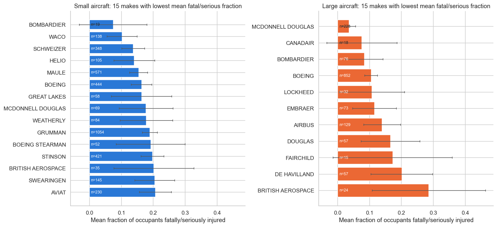
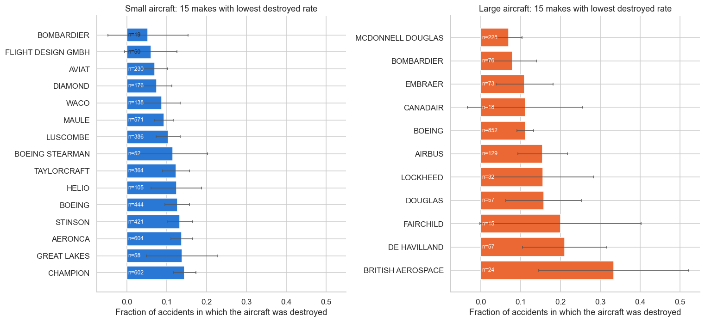
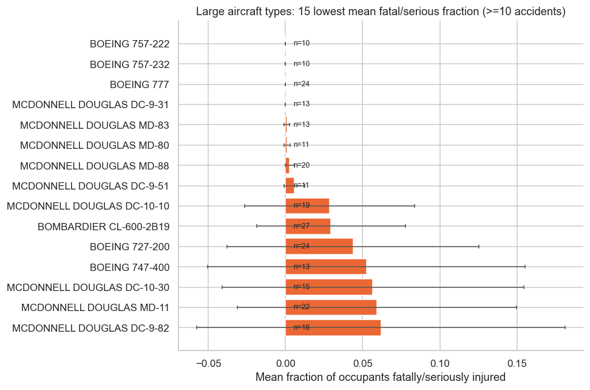
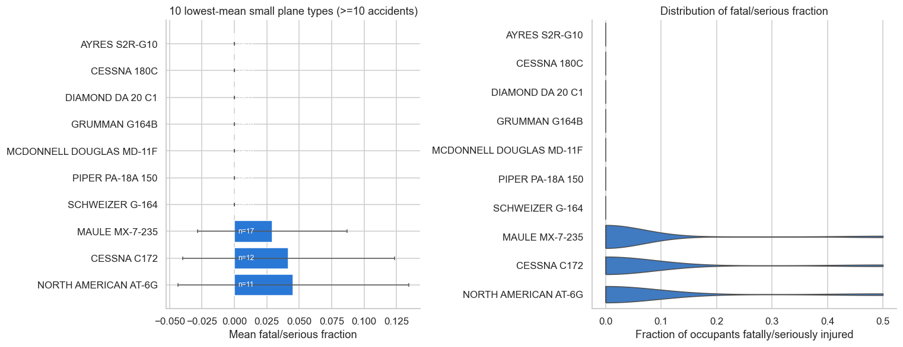
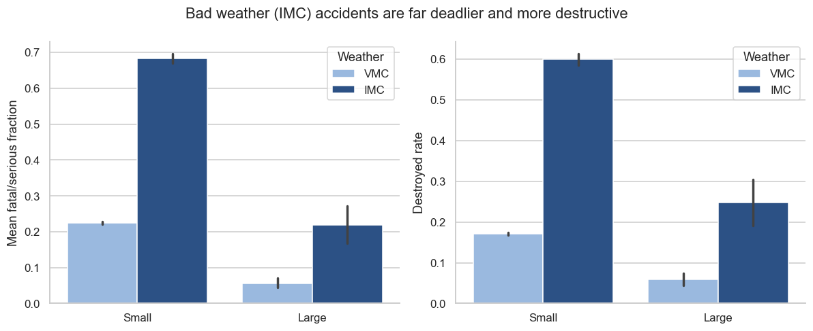
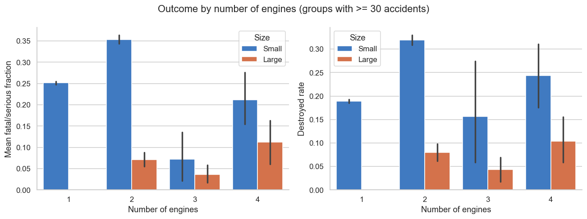
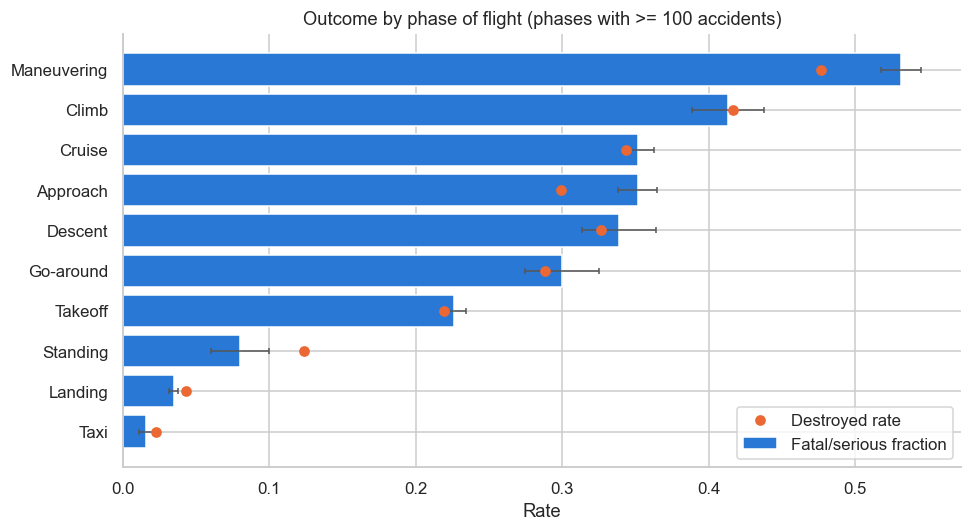

# Aviation Accident Analysis
# Aviation Accident Analysis: Which Aircraft Are Safest to Insure?

**Author:** Ian Wakali ([@Wakali-Ian](https://github.com/Wakali-Ian))

## Business problem
An airline/aircraft insurer wants to know which airplane **makes and models** have a low rate of total destruction and a low likelihood of fatal or serious occupant injury **when an accident happens**, and which general conditions drive those outcomes. The client wants **separate recommendations for small aircraft and larger passenger aircraft**, and only for professionally built airplanes that could still be flying (events from **1983** onward, assuming a 40-year aircraft life).

## Data
NTSB aviation accident records (1948-2022, 88,889 rows) in `data/AviationData.csv`. After cleaning: about **60,000 accidents, 56 makes and about 4,700 plane types** (`data/cleaned_aviation_data.csv`).

## Repository structure
```
.
├── Aviation_Accidents_Cleaning.ipynb        # Part 1: load, inspect, clean, derive metrics, save csv
├── Aviation_Accidents_Data_Analysis.ipynb   # Part 2: EDA, recommendations, other factors
├── data/
│   ├── AviationData.csv                     # raw data
│   ├── USState_Codes.csv
│   └── cleaned_aviation_data.csv            # output of notebook 1
├── images/                                  # figures used below
└── README.md
```

## Method
- **Filters:** airplanes only (missing `Aircraft.Category` was imputed from make/model, then make, then engine type); professional builds only (`Amateur.Built == No`); events from 1983 onward.
- **Metrics:** `Fatal.Serious.Fraction = (fatal + serious) / total occupants`; `Destroyed = 1` if the aircraft was destroyed.
- **Cleaning:** standardised and merged make names; kept makes with at least 50 records; created `Plane.Type = Make + Model` because model labels are not unique across makes; turned placeholders (`Unknown`, `UNK`) into missing values; grouped or removed rare categories; dropped columns with 20,000 or fewer non-null values.
- **Small vs large:** a plane type is *large* if at least 25% of its accidents had 20 or more people aboard (threshold of 20 applied per plane type, so one data error cannot turn a light aircraft into a jet).
- **Statistical robustness:** minimum 10 accidents per group (30 in a robustness check), 95% confidence intervals on the bar charts, and chi-square, Mann-Whitney and Kruskal-Wallis tests for the factor analysis.

## Key findings
Baseline per accident: **small** aircraft have 27.5% of occupants fatally/seriously injured and 21.4% destroyed; **large** aircraft have 10.7% and 11.8%.

### Recommended makes
| | Recommended (well supported) | Worth watching (small samples) |
|---|---|---|
| Small | **Maule** (n=571, 15.4% injured, 9.3% destroyed), **Aviat**, **Waco**, **Helio**, **Diamond** | Bombardier small models (n=19) |
| Large | **McDonnell Douglas** (n=228, 3.6% / 7.0%), **Boeing** (n=852, 10.5% / 11.2%) | Bombardier, Embraer, Canadair |




### Recommended plane types
- **Large:** Boeing 777, Boeing 757, McDonnell Douglas MD-88 / MD-80 / DC-9-31, Bombardier CL-600-2B19 and Boeing 727-200. The Boeing 737 is solid and the best measured (n=121, 13.4%).
- **Small (at least 30 accidents):** Piper PA-18-160 and PA-20, Cessna 180A and 185 family, Beech C-23.




### Factors that drive outcomes
1. **Weather:** an accident in instrument conditions (IMC) injures 68% (small) and 22% (large) of occupants, versus 23% and 6% in visual conditions (VMC). It also destroys the aircraft 60% and 25% of the time, versus 17% and 6% (p < 1e-15).



2. **Number of engines:** twin-engine light aircraft do *worse* (35% injured, 32% destroyed) than single-engine ones (25%, 19%). For large jets the engine count makes no significant difference.



3. **Phase of flight (bonus):** taxi and landing accidents are mostly minor (under 4% injured), while maneuvering (53%), climb (41%) and cruise (35%) are the deadliest.



## Recommendations
- Prefer **McDonnell Douglas** and **Boeing** for large aircraft and **Maule, Aviat, Waco, Helio and Diamond** for small aircraft.
- Treat **weather exposure (instrument flying)** as a major pricing factor.
- Do not give a blanket discount for multi-engine light aircraft.

## Limitations
- There are no flight-hour (exposure) data, so the figures are *risk given an accident*, not accident rates.
- Occupancy is used as a proxy for aircraft size, so cargo jets with few crew can fall in the "small" group.
- Some model spellings were not merged (for example `PA-28-140` and `PA28-140`).
- Factor results are associations and are not controlled for pilot experience or type of operation.

## How to run
```bash
pip install pandas numpy matplotlib seaborn scipy jupyter
jupyter notebook   # run the Cleaning notebook first, then the Data Analysis notebook
```
